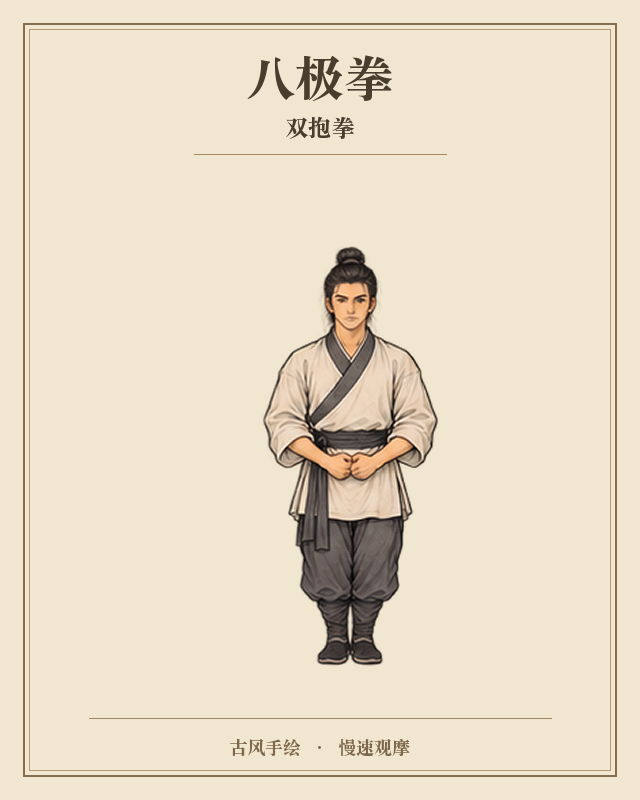

# 八极拳古风手绘动态图谱

同一人物、古籍线描淡彩风格的八极拳动作观摩资料：一套《小八极》完整套路，加三项独立肘法、靠法补充。每张图一个姿势，连续帧可合成播放。

[下载全部资料与原始制作文件](https://github.com/nikochen1997/bajiquan-illustrated-manual/releases/tag/v1.0.0) · [完整慢放视频](outputs/八极拳完整篇/八极拳-完整套路慢放.mp4) · [动作目录与来源](outputs/八极拳完整篇/动作目录与来源.txt) · [测试报告](outputs/八极拳完整篇/测试报告.md)

## 内容

| 内容 | 数量 / 规格 |
| --- | --- |
| 单姿势图 | 427 张：342 张关键姿态 + 85 张额外过渡控制图 |
| 连续播放帧 | 4,857 张 PNG：主套路 4,469 张 + 补充 388 张 |
| 视频 | 39 个：完整主视频 1 个、主套路分招 35 个、补充分招 3 个 |
| 主视频 | 3 分 06.208 秒，640 × 800，24 fps，H.264 |
| 原始制作资料 | 绘图原稿、来源记录、制作脚本、测试、历史版本、工具及安装包 |

这是一套来源对照的 AI 重绘、补间观摩版。细微拳掌、肩胯和角度未经拳师校订；画面中仍有轻微衣褶变化、手指软化和遮挡。它覆盖的是所选版本的《小八极》，不是所有流派的全部八极拳内容。

## 下载与播放

仓库直接提供 427 张单姿势图、全部 39 个视频、离线播放页、来源与测试资料，以及制作源码。点击单个视频页面的下载按钮可保存原 MP4。

在 [Releases](https://github.com/nikochen1997/bajiquan-illustrated-manual/releases/tag/v1.0.0) 中：

1. **先看成品**：下载“427张单姿势图与全部视频”ZIP，解压后打开 `打开播放.html`，可切换章节、速度与逐帧查看。
2. **需要所有逐帧图**：下载两份“全部4857张逐帧图”ZIP，解压到同一目录。两份均为独立 ZIP，不是二进制分卷。
3. **需要整个项目**：下载所有 `full-project-*-part*.tar`。每份都是独立 TAR，逐份解压到同一空目录，即可还原 `work/`、`outputs/` 和 `external-generated-images/`。这包含早期样片、未采用原稿、中间画面、最终成品，以及相关工具安装包；其中历史重复文件按原路径保留。

完整下载目录、逐文件 SHA-256 和各下载资产 SHA-256 随 Release 提供。`full-project-inventory.json` 记录原始文件；`publication-verification.json` 记录实际发布后的校验结果。操作审计临时目录与 macOS `.DS_Store` 不属于制作素材，不收入原始归档。

## 来源与动作范围

主套路依据 hsu363 发布的字幕版 [《小八極》](https://www.youtube.com/watch?v=nfBG8Je-wVY)，取原片 0–123.981 秒，35 个字幕段连续排列。独立片没有另署示范者姓名，故不自行推定。字幕切点精度约 0.5–1 秒。

三项补充来自 WuTan NJ + BajiShu 的公开视频，独立列出，不插入主套路次序：

- [两仪顶 / 顶心肘](https://www.youtube.com/watch?v=mlGl7kjr1NA)：短入桩定式。
- [收势献肘](https://www.youtube.com/watch?v=DnzZKZXqZ7U)：上提、滚转、下沉过程。
- [铁山靠](https://www.youtube.com/watch?v=gVWY7j2HFyg)：保留练功靶和远侧肢体遮挡。

口述“贴心肘”与字幕“顶心肘”的同名关系未核实。早期撑拳样片另依据 [国家体育总局《八极拳健身操》](https://www.sport.gov.cn/n20001280/n20001265/n20066978/c20287390/content.html)，不作为传统完整套路。

## 源码与复现

主要脚本位于 `work/八极拳完整篇/`，早期样片位于 `work/八极撑拳样片/`。原始制作记录保留当时的本机绝对路径；换机时需将路径改为自己的解压目录。已导出的图片和视频不需要重新制作即可使用。

复现环境以 macOS 为主：Python 3.9+、Pillow、NumPy、FFmpeg；部分脚本还使用 OpenCV、fontTools、Node.js 与 RIFE ncnn Vulkan。标题排版使用 macOS 宋体，RIFE 原安装包面向 macOS；其他系统需要另装兼容工具和字体。项目未验证跨平台一键复现。

生产清单是冻结的历史指纹，不能简单把内部旧计数改成最终数值；末次修复的新增控制图、绑定哈希和计划见额外修复记录。最终数量以交付清单和测试报告为准。

技术核对：33 项工具测试通过，1 项既有 CSV 文件句柄 Bug 回归测试跳过。全部最终 PNG 已解码、39 个 MP4 已完整解码；38 段画面抽查，8 个修复区间共 135 帧逐张查看。离线 HTML 的脚本和引用已检查，未声称完成真实浏览器运行验收。

## 许可

本项目自行编写的代码及可授权的原创生成图像、视频采用 [MIT License](LICENSE)。第三方演示资料、网页、字体、工具、模型、可执行文件及依赖不受根 MIT 许可重新授权，各自权利与原许可保留。参见 [第三方说明](third-party/NOTICE.md) 及 `third-party/`。

公开参考视频的引用不表示原作者认可本项目，也不表示已取得其原视频的再许可。
